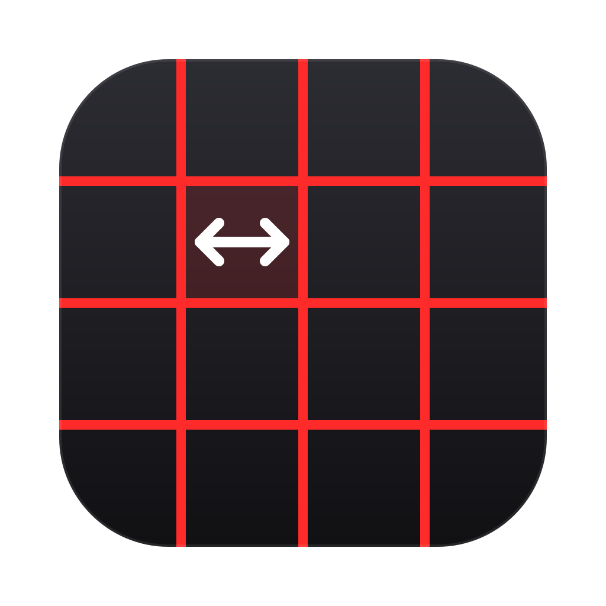
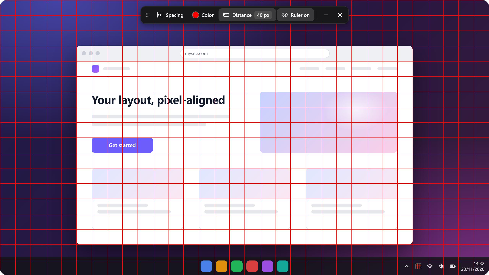
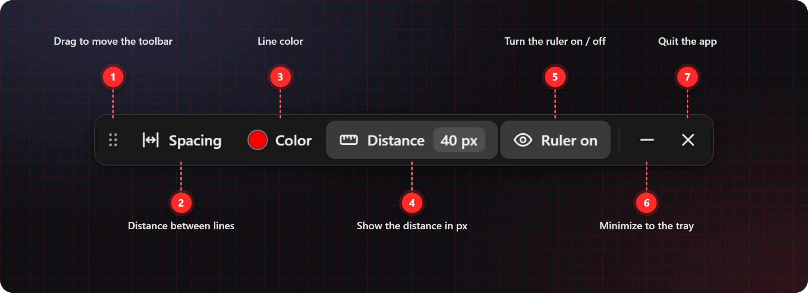
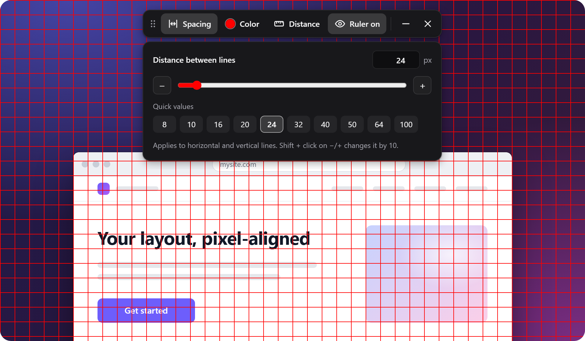
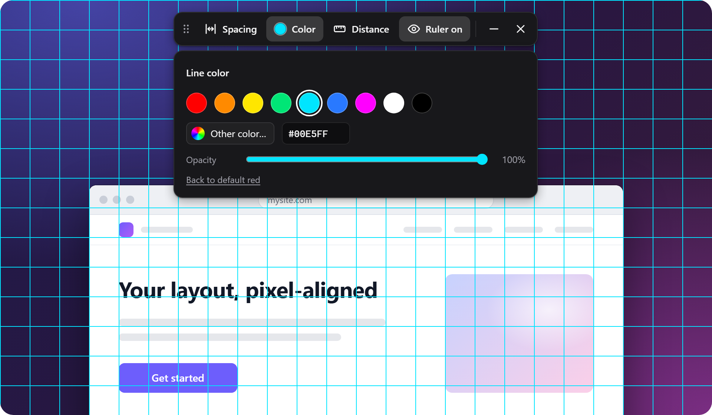
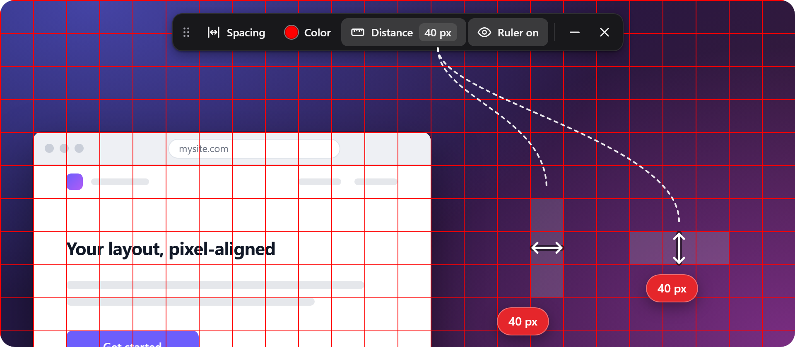
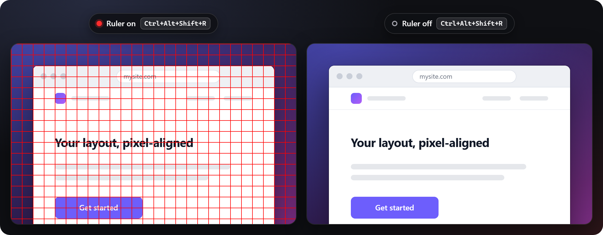
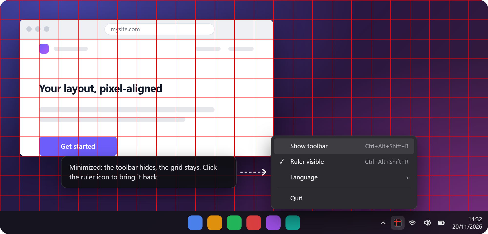
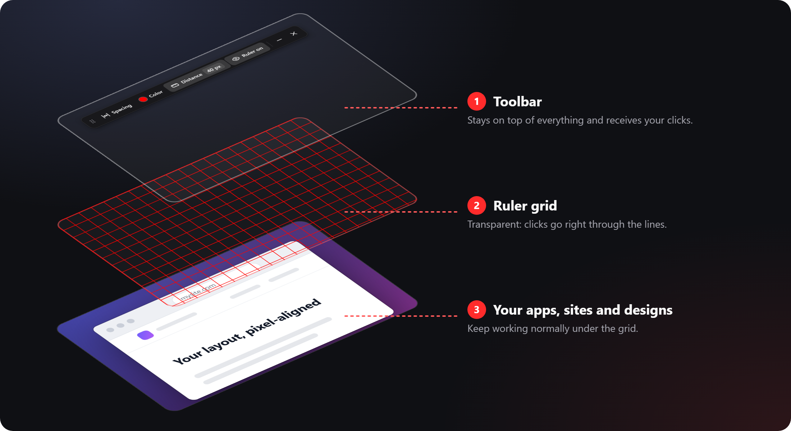

<div align="center">



# Layout Screen Ruler

**A grid of lines over your whole screen to check layout alignment.**
For Windows, macOS and Linux. Free and open source.

[](https://github.com/gabriborges/layout-screen-ruler/releases/latest)
[](https://github.com/gabriborges/layout-screen-ruler/releases)
[](#-download)
[](LICENSE)

🇺🇸 English · [🇧🇷 Português](README.pt-BR.md)

<br />



</div>

---

**Layout Screen Ruler** draws evenly spaced horizontal and vertical red lines on top of
**everything** on your screen — browser, Figma, code editor, any app. It makes it easy to
see whether buttons, cards, text and margins line up.

The grid is **transparent to the mouse**: you keep clicking, scrolling and typing in the
apps underneath it. There are no numbers, centimeters or labels on screen — just lines.

## ✨ Features

- 📐 **Grid over the whole screen**, on every connected monitor
- ↔️ **Adjustable distance between lines** (4 to 1000 px), with quick presets
- 🎨 **Line color** — red by default, 9 ready-made colors or any other, with opacity
- 🔢 **Shows the current distance in pixels** on the toolbar
- 👁️ **Turn the ruler on and off** with one click or a keyboard shortcut
- 📥 **Minimize to the system tray** — the grid stays, the toolbar hides
- 🖱️ **Clicks go through the grid** — it never gets in your way
- 💾 **Remembers your preferences** (distance, color, toolbar position)
- 🌎 **English and Portuguese** interface (follows the system, or pick one in the tray menu)

## 📥 Download

Download the file for your system (always the latest version):

| System | File | |
| --- | --- | --- |
| **Windows 10/11** — installer | `Layout-Screen-Ruler-Windows-Setup.exe` | [⬇️ Download](https://github.com/gabriborges/layout-screen-ruler/releases/latest/download/Layout-Screen-Ruler-Windows-Setup.exe) |
| **Windows** — portable (no install) | `Layout-Screen-Ruler-Windows-Portable.exe` | [⬇️ Download](https://github.com/gabriborges/layout-screen-ruler/releases/latest/download/Layout-Screen-Ruler-Windows-Portable.exe) |
| **macOS** — Apple Silicon (M1, M2, M3, M4…) | `Layout-Screen-Ruler-macOS-arm64.dmg` | [⬇️ Download](https://github.com/gabriborges/layout-screen-ruler/releases/latest/download/Layout-Screen-Ruler-macOS-arm64.dmg) |
| **macOS** — Intel | `Layout-Screen-Ruler-macOS-x64.dmg` | [⬇️ Download](https://github.com/gabriborges/layout-screen-ruler/releases/latest/download/Layout-Screen-Ruler-macOS-x64.dmg) |
| **Linux** — AppImage (any distro) | `Layout-Screen-Ruler-Linux-x86_64.AppImage` | [⬇️ Download](https://github.com/gabriborges/layout-screen-ruler/releases/latest/download/Layout-Screen-Ruler-Linux-x86_64.AppImage) |
| **Linux** — Debian / Ubuntu (.deb) | `Layout-Screen-Ruler-Linux-amd64.deb` | [⬇️ Download](https://github.com/gabriborges/layout-screen-ruler/releases/latest/download/Layout-Screen-Ruler-Linux-amd64.deb) |

All versions and release notes are on the
[**Releases**](https://github.com/gabriborges/layout-screen-ruler/releases) page.

> **Not sure which Mac you have?** Click the  menu › **About This Mac**. If it says
> "Apple M… chip", get **Apple Silicon**; if it says "Intel processor", get **Intel**.

## 💻 Installation

<details open>
<summary><b>Windows</b></summary>

1. Download the **installer** (`…-Windows-Setup.exe`) and open it.
2. If you see **"Windows protected your PC"** (SmartScreen), click
   **More info › Run anyway**. This happens because the app is free and has no paid
   code-signing certificate — it is not a virus, and all of the code is right here.
3. Follow the installer. Shortcuts are created on the Desktop and in the Start menu.

Rather not install anything? Use the **portable** version (`…-Windows-Portable.exe`).

</details>

<details open>
<summary><b>macOS</b></summary>

1. Download the `.dmg` for your Mac, open it and **drag the app into Applications**.
2. The **first time**, macOS blocks apps without an Apple certificate. To allow it:
   - open **System Settings › Privacy & Security**, scroll to the message about
     Layout Screen Ruler and click **Open Anyway**; **or**
   - run this in Terminal:
     ```bash
     xattr -dr com.apple.quarantine "/Applications/Layout Screen Ruler.app"
     ```
3. The app lives in the **menu bar** (next to the clock), not in the Dock.

</details>

<details open>
<summary><b>Linux</b></summary>

**AppImage** (works on most distros):

```bash
chmod +x Layout-Screen-Ruler-Linux-x86_64.AppImage
./Layout-Screen-Ruler-Linux-x86_64.AppImage
```

> On Ubuntu 22.04+ you may need FUSE: `sudo apt install libfuse2t64`
> (or `libfuse2` on older releases).

**Debian / Ubuntu (.deb):**

```bash
sudo apt install ./Layout-Screen-Ruler-Linux-amd64.deb
```

Then search for **Layout Screen Ruler** in your app menu.

</details>

## 📖 How to use

### 1. Open the app

The **red grid** appears over the whole screen and the **toolbar** appears centered at
the top. Keep using your computer normally: clicks go through the grid.

### 2. Meet the toolbar

<p align="center">
  
</p>

| # | Button | What it does |
| :-: | --- | --- |
| 1 | **⠿ Handle** | Click and drag to move the toolbar anywhere on screen. |
| 2 | **Spacing** | Opens the panel to change the **distance between lines**. |
| 3 | **Color** | Opens the panel to change the line **color** (and opacity). |
| 4 | **Distance** | Shows/hides the **current distance in pixels** between lines. |
| 5 | **Ruler on / off** | **Turns the grid on or off**. |
| 6 | **—** | **Minimizes to the system tray** (the grid stays visible). |
| 7 | **✕** | **Quits the app** completely. |

### 3. Change the distance between lines

Click **Spacing**. In the panel you can:

- drag the **slider**;
- type the exact value in the **px** field (4 to 1000) and press <kbd>Enter</kbd>;
- use the **−** and **+** buttons (hold <kbd>Shift</kbd> to change by 10);
- pick one of the **quick values** (8, 10, 16, 20, 24, 32, 40, 50, 64, 100).

The same distance applies to horizontal and vertical lines, and the grid updates
instantly.

<p align="center">
  
</p>

> 💡 **Tip:** hover the **Spacing** button and turn the **mouse wheel** for quick changes
> (hold <kbd>Shift</kbd> to change by 10).

### 4. Change the line color

Click **Color**. Lines are **red by default**, but you can:

- pick one of the **9 ready-made colors**;
- click **Other color…** to open the system color picker;
- type a hex code (e.g. `#00E5FF`);
- adjust the line **opacity** (10% to 100%);
- click **Back to default red** to restore it.

<p align="center">
  
</p>

### 5. See the distance in pixels

Click **Distance** to show, right on the toolbar, how many pixels there are from one line
to the next (e.g. **40 px**). Click again to hide it. The value follows any spacing change.

<p align="center">
  
</p>

### 6. Turn the ruler on and off

Click **Ruler on** to hide the grid (the button then reads **Ruler off**). Click again to
show it. The <kbd>Ctrl</kbd>+<kbd>Alt</kbd>+<kbd>Shift</kbd>+<kbd>R</kbd> shortcut works
too, even with the toolbar minimized.

<p align="center">
  
</p>

### 7. Minimize to the tray

Click **—** to hide the toolbar. **The grid stays on screen** and the app keeps running
as an icon in the **system tray** (near the clock; on macOS, in the menu bar).

- **Click the icon** to bring the toolbar back (Windows/Linux);
- or use the **icon menu**: _Show toolbar_, _Ruler visible_, _Language_ and _Quit_;
- or press <kbd>Ctrl</kbd>+<kbd>Alt</kbd>+<kbd>Shift</kbd>+<kbd>B</kbd>.

<p align="center">
  
</p>

> On Windows the icon may be hidden behind the **^** arrow in the tray. Drag it out to
> keep it always visible.

### 8. Quit

Click **✕** on the toolbar (or **Quit** in the tray menu). Your preferences are saved for
next time.

## ⌨️ Keyboard shortcuts

They work in any app, even with the toolbar minimized:

| Action | Windows / Linux | macOS |
| --- | --- | --- |
| Turn the ruler on / off | <kbd>Ctrl</kbd>+<kbd>Alt</kbd>+<kbd>Shift</kbd>+<kbd>R</kbd> | <kbd>⌘</kbd>+<kbd>⌥</kbd>+<kbd>⇧</kbd>+<kbd>R</kbd> |
| Show / hide the toolbar | <kbd>Ctrl</kbd>+<kbd>Alt</kbd>+<kbd>Shift</kbd>+<kbd>B</kbd> | <kbd>⌘</kbd>+<kbd>⌥</kbd>+<kbd>⇧</kbd>+<kbd>B</kbd> |
| Close the open panel | <kbd>Esc</kbd> | <kbd>Esc</kbd> |

## 🧩 How it works

<p align="center">
  
</p>

The app opens a **transparent, frameless, always-on-top** window on each monitor and draws
the grid in it. That window **ignores the mouse**, so clicks reach the apps underneath. The
toolbar is a separate window that stays above the grid.

- **Multiple monitors:** each monitor gets its own grid, starting at its top-left
  corner. Connecting or disconnecting monitors updates everything automatically.
- **Logical pixels:** distance is measured in **logical** pixels — the same `px` as CSS at
  100% zoom. At 150% display scaling, for example, 40 logical px take up 60 physical
  pixels; in that case the spacing panel shows the conversion.
- **Preferences** are stored in a `settings.json` file:
  - Windows: `%APPDATA%\Layout Screen Ruler\`
  - macOS: `~/Library/Application Support/Layout Screen Ruler/`
  - Linux: `~/.config/Layout Screen Ruler/`

## ❓ FAQ

<details>
<summary><b>How do I change the language?</b></summary>

By default the app uses your system display language. Click the ruler icon in the tray
› **Language** (or **Idioma**) and pick one. Your choice is saved.

</details>

<details>
<summary><b>I minimized it and can't find the app. Now what?</b></summary>

It's still running in the system tray. Press
<kbd>Ctrl</kbd>+<kbd>Alt</kbd>+<kbd>Shift</kbd>+<kbd>B</kbd> (<kbd>⌘⌥⇧B</kbd> on a Mac) to
bring the toolbar back. Opening the app again also shows the toolbar.

</details>

<details>
<summary><b>Linux: there is no tray icon (GNOME)</b></summary>

GNOME doesn't show tray icons by default. Install the
[AppIndicator and KStatusNotifierItem Support](https://extensions.gnome.org/extension/615/appindicator-support/)
extension (Ubuntu ships with it enabled). Without it, use
<kbd>Ctrl</kbd>+<kbd>Alt</kbd>+<kbd>Shift</kbd>+<kbd>B</kbd>.

</details>

<details>
<summary><b>Linux: the grid has a black background</b></summary>

Transparent windows need a running compositor (the default on GNOME, KDE, Cinnamon,
etc.). On minimal window managers (i3, Openbox…), enable a compositor such as `picom`.

</details>

<details>
<summary><b>Linux: what about Wayland?</b></summary>

The app runs through XWayland automatically, because on native Wayland "always on top",
click-through windows and global shortcuts aren't reliable. To try native Wayland anyway,
start it with the `LSR_WAYLAND=1` environment variable.

</details>

<details>
<summary><b>A keyboard shortcut doesn't work</b></summary>

Another program may already use the same key combination. The toolbar buttons and the
tray menu keep working normally.

</details>

<details>
<summary><b>The grid goes under an app or a full-screen game</b></summary>

Some exclusive full-screen apps (mostly games) stay above every window. Use the app's
"borderless window" mode, if it has one.

</details>

## 🛠️ For developers

Requirements: [Node.js](https://nodejs.org) 20 or later.

```bash
git clone https://github.com/gabriborges/layout-screen-ruler.git
cd layout-screen-ruler
npm install
npm start          # runs the app in development mode
```

| Command | What it does |
| --- | --- |
| `npm start` | Runs the app from source (window errors are printed to the terminal). |
| `npm run dist` | Builds installers for the current OS into `dist/`. |
| `npm run dist:win` / `dist:mac` / `dist:linux` | Builds for a specific OS. |
| `npm run assets` | Regenerates the icons and **every image in this documentation** from the real UI (`-- --icons` or `-- --docs` for just one part). |

> If `npm start` exits without opening anything inside the VS Code terminal, check
> whether the `ELECTRON_RUN_AS_NODE` variable is set — it makes Electron run as Node.

### Project structure

```
src/
  main/        main process: windows, tray, shortcuts, preferences
  preload/     secure bridge between the windows and the main process
  renderer/    grid (overlay) and toolbar (HTML/CSS/JS)
  shared/      defaults and UI strings (pt/en)
assets/        icons used by the running app (tray, window)
build/         source icons (SVG) and installer icon
scripts/       icon and documentation image generator
docs/          images and guides
.github/       automated releases (GitHub Actions)
```

### Releasing a new version

GitHub Actions builds for Windows, macOS and Linux and publishes the installers on the
Releases page whenever a `v*` tag is pushed. Step by step (in Portuguese) in
[**docs/PUBLICAR.md**](docs/PUBLICAR.md).

## 🤝 Contributing

Suggestions and fixes are welcome! See the [contributing guide](CONTRIBUTING.md) and open
an [issue](https://github.com/gabriborges/layout-screen-ruler/issues).

## 📄 License

[MIT](LICENSE) © 2026 Gabriel Borges
