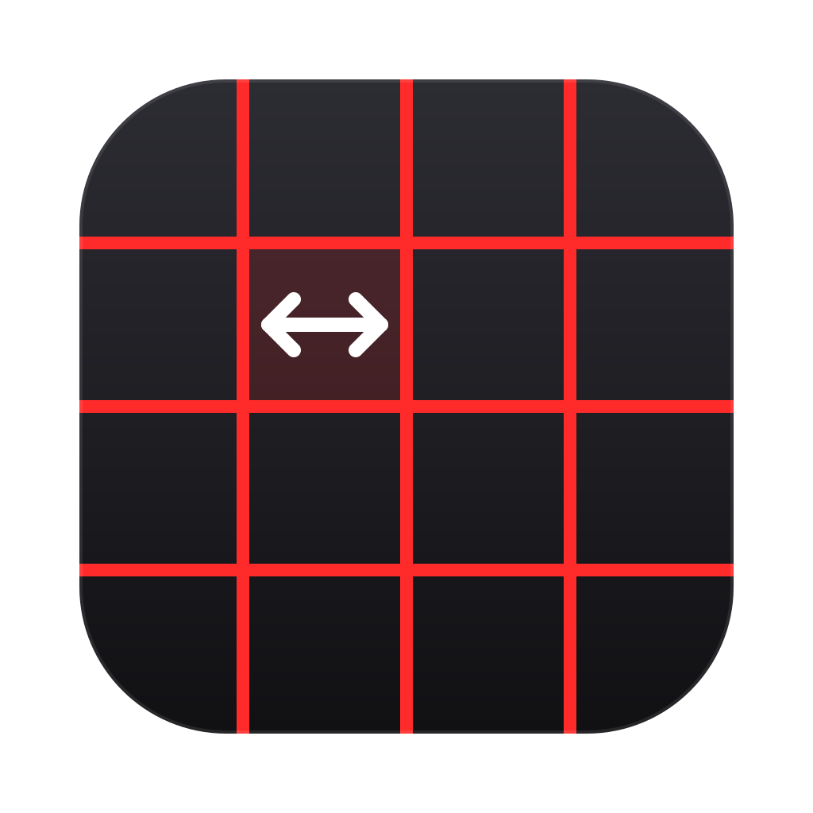
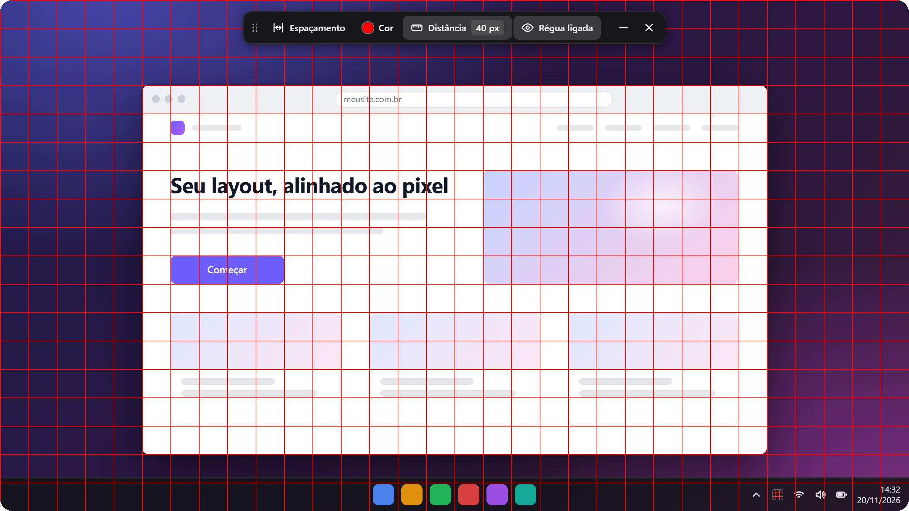
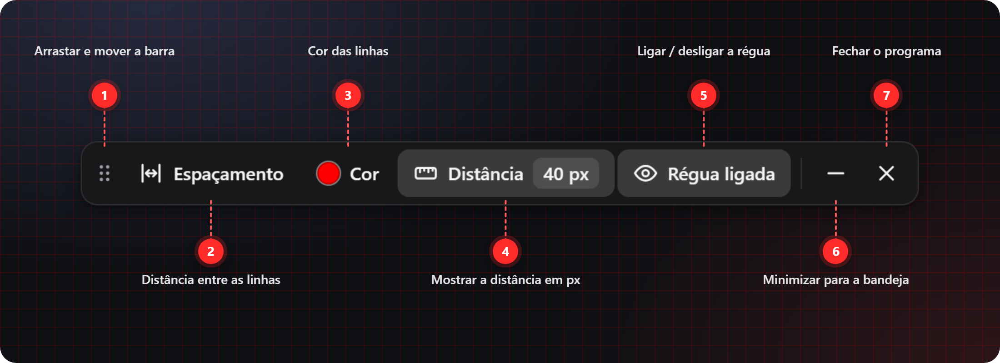
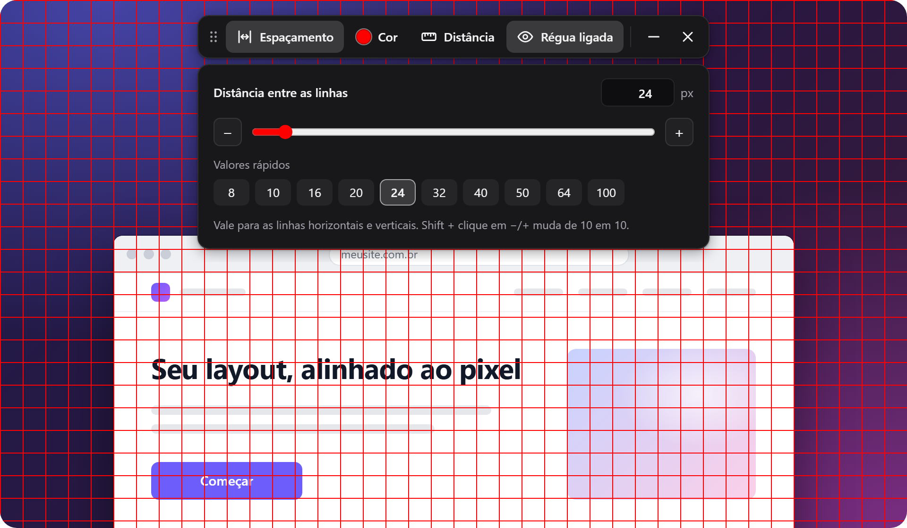
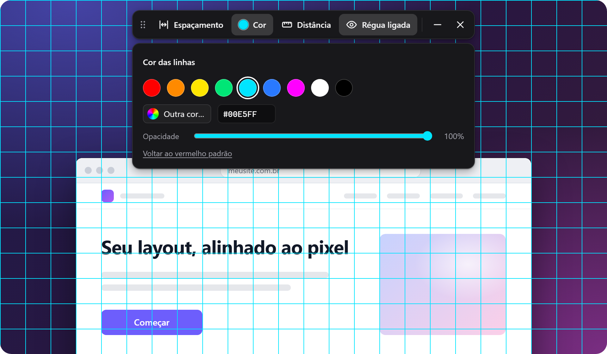
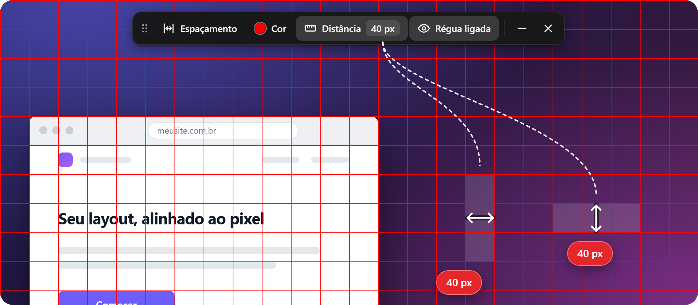
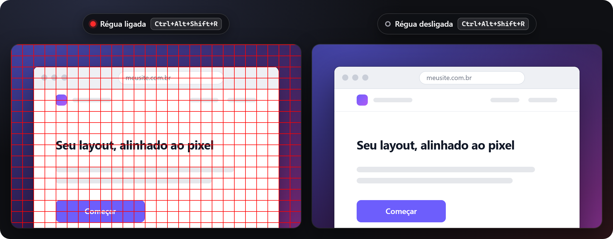
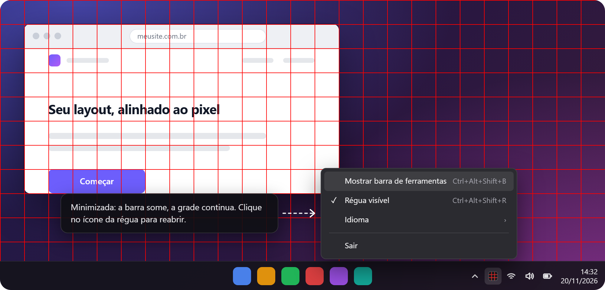
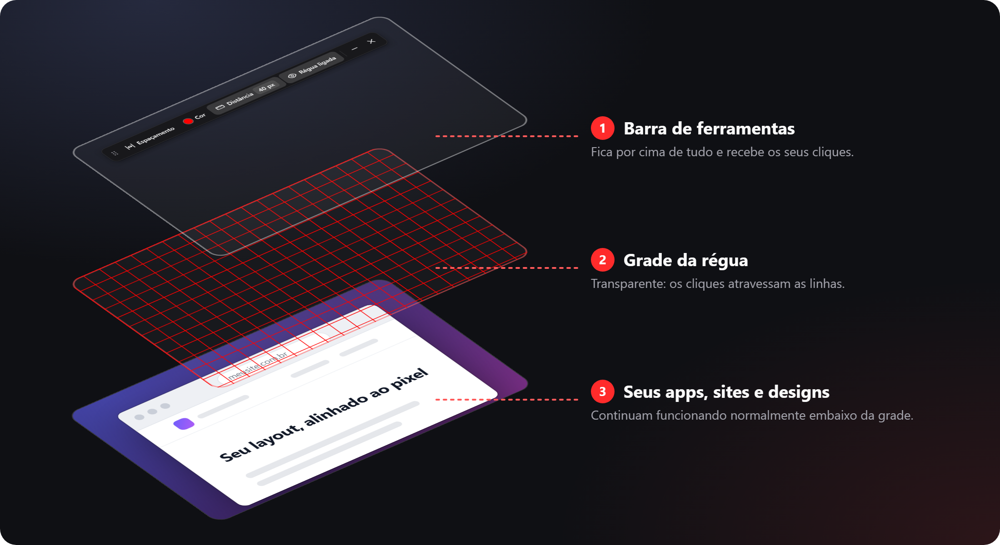

<div align="center">



# Layout Screen Ruler

**Uma grade de linhas sobre a tela inteira para conferir alinhamentos de layout.**
Para Windows, macOS e Linux. Grátis e open source.

[](https://github.com/gabriborges/layout-screen-ruler/releases/latest)
[](https://github.com/gabriborges/layout-screen-ruler/releases)
[](#-download)
[](LICENSE)

[🇺🇸 English](README.md) · 🇧🇷 Português

<br />



</div>

---

O **Layout Screen Ruler** desenha linhas vermelhas horizontais e verticais, igualmente
espaçadas, por cima de **tudo** o que está na sua tela — navegador, Figma, editor de
código, qualquer app. Assim fica fácil ver se botões, cards, textos e margens estão
alinhados.

A grade é **transparente para o mouse**: você continua clicando, rolando e digitando
normalmente nos apps que estão embaixo dela. Não há números, centímetros ou marcações
na tela — só as linhas.

## ✨ Recursos

- 📐 **Grade sobre a tela inteira**, em todos os monitores conectados
- ↔️ **Distância entre as linhas ajustável** (de 4 a 1000 px), com valores rápidos
- 🎨 **Cor das linhas** — vermelho por padrão, 9 cores prontas ou qualquer outra, com opacidade
- 🔢 **Mostra a distância atual em pixels** na barra de ferramentas
- 👁️ **Liga e desliga a régua** com um clique ou atalho de teclado
- 📥 **Minimiza para a bandeja do sistema** — a grade continua na tela, a barra some
- 🖱️ **Os cliques atravessam a grade** — ela nunca atrapalha o seu trabalho
- 💾 **Lembra as suas preferências** (distância, cor, posição da barra)
- 🌎 Interface em **português e inglês** (segue o sistema ou escolha no menu da bandeja)

## 📥 Download

Baixe o arquivo do seu sistema (sempre a versão mais recente):

| Sistema | Arquivo | |
| --- | --- | --- |
| **Windows 10/11** — instalador | `Layout-Screen-Ruler-Windows-Setup.exe` | [⬇️ Baixar](https://github.com/gabriborges/layout-screen-ruler/releases/latest/download/Layout-Screen-Ruler-Windows-Setup.exe) |
| **Windows** — portátil (não instala nada) | `Layout-Screen-Ruler-Windows-Portable.exe` | [⬇️ Baixar](https://github.com/gabriborges/layout-screen-ruler/releases/latest/download/Layout-Screen-Ruler-Windows-Portable.exe) |
| **macOS** — Apple Silicon (M1, M2, M3, M4…) | `Layout-Screen-Ruler-macOS-arm64.dmg` | [⬇️ Baixar](https://github.com/gabriborges/layout-screen-ruler/releases/latest/download/Layout-Screen-Ruler-macOS-arm64.dmg) |
| **macOS** — Intel | `Layout-Screen-Ruler-macOS-x64.dmg` | [⬇️ Baixar](https://github.com/gabriborges/layout-screen-ruler/releases/latest/download/Layout-Screen-Ruler-macOS-x64.dmg) |
| **Linux** — AppImage (qualquer distro) | `Layout-Screen-Ruler-Linux-x86_64.AppImage` | [⬇️ Baixar](https://github.com/gabriborges/layout-screen-ruler/releases/latest/download/Layout-Screen-Ruler-Linux-x86_64.AppImage) |
| **Linux** — Debian / Ubuntu (.deb) | `Layout-Screen-Ruler-Linux-amd64.deb` | [⬇️ Baixar](https://github.com/gabriborges/layout-screen-ruler/releases/latest/download/Layout-Screen-Ruler-Linux-amd64.deb) |

Todas as versões e notas de lançamento ficam na página
[**Releases**](https://github.com/gabriborges/layout-screen-ruler/releases).

> **Não sabe qual Mac você tem?** Clique no menu  › **Sobre Este Mac**. Se aparecer
> "Chip Apple M…", baixe **Apple Silicon**; se aparecer "Processador Intel", baixe **Intel**.

## 💻 Instalação

<details open>
<summary><b>Windows</b></summary>

1. Baixe o **instalador** (`…-Windows-Setup.exe`) e abra.
2. Se aparecer **"O Windows protegeu o computador"** (SmartScreen), clique em
   **Mais informações › Executar assim mesmo**. Isso acontece porque o app é gratuito e não
   tem um certificado de assinatura pago — não é um vírus, e o código está todo aqui.
3. Siga o instalador. Um atalho é criado na Área de Trabalho e no Menu Iniciar.

Prefere não instalar? Use a versão **portátil** (`…-Windows-Portable.exe`): é só abrir.

</details>

<details open>
<summary><b>macOS</b></summary>

1. Baixe o `.dmg` do seu tipo de Mac, abra e **arraste o app para a pasta Aplicativos**.
2. Na **primeira vez**, o macOS bloqueia apps sem certificado da Apple. Para liberar:
   - abra **Ajustes do Sistema › Privacidade e Segurança**, role até o aviso sobre o
     Layout Screen Ruler e clique em **Abrir Mesmo Assim**; **ou**
   - no Terminal, rode:
     ```bash
     xattr -dr com.apple.quarantine "/Applications/Layout Screen Ruler.app"
     ```
3. O app fica na **barra de menus** (ao lado do relógio), não no Dock.

</details>

<details open>
<summary><b>Linux</b></summary>

**AppImage** (funciona na maioria das distros):

```bash
chmod +x Layout-Screen-Ruler-Linux-x86_64.AppImage
./Layout-Screen-Ruler-Linux-x86_64.AppImage
```

> No Ubuntu 22.04+ pode ser preciso instalar o FUSE: `sudo apt install libfuse2t64`
> (ou `libfuse2` em versões mais antigas).

**Debian / Ubuntu (.deb):**

```bash
sudo apt install ./Layout-Screen-Ruler-Linux-amd64.deb
```

Depois é só procurar **Layout Screen Ruler** no menu de aplicativos.

</details>

## 📖 Como usar

### 1. Abra o programa

Ao abrir, a **grade vermelha** aparece sobre a tela inteira e a **barra de ferramentas**
aparece no topo, centralizada. Pode continuar usando o computador normalmente: os
cliques passam pela grade.

### 2. Conheça a barra de ferramentas

<p align="center">
  
</p>

| # | Botão | O que faz |
| :-: | --- | --- |
| 1 | **⠿ Alça** | Clique e arraste para mover a barra para qualquer lugar da tela. |
| 2 | **Espaçamento** | Abre o painel para mudar a **distância entre as linhas**. |
| 3 | **Cor** | Abre o painel para mudar a **cor** (e a opacidade) das linhas. |
| 4 | **Distância** | Mostra/oculta a **distância atual em pixels** entre as linhas. |
| 5 | **Régua ligada / desligada** | **Liga ou desliga** a grade na tela. |
| 6 | **—** | **Minimiza para a bandeja** do sistema (a grade continua visível). |
| 7 | **✕** | **Fecha o programa** completamente. |

### 3. Mude a distância entre as linhas

Clique em **Espaçamento**. No painel você pode:

- arrastar o **controle deslizante**;
- digitar o valor exato no campo **px** (de 4 a 1000) e apertar <kbd>Enter</kbd>;
- usar os botões **−** e **+** (com <kbd>Shift</kbd>, de 10 em 10);
- escolher um dos **valores rápidos** (8, 10, 16, 20, 24, 32, 40, 50, 64, 100).

A mesma distância vale para as linhas horizontais e verticais, e a grade muda na hora.

<p align="center">
  
</p>

> 💡 **Atalho:** passe o mouse sobre o botão **Espaçamento** e gire a **rodinha do mouse**
> para aumentar/diminuir rapidamente (com <kbd>Shift</kbd>, de 10 em 10).

### 4. Mude a cor das linhas

Clique em **Cor**. As linhas são **vermelhas por padrão**, mas você pode:

- escolher uma das **9 cores prontas**;
- clicar em **Outra cor…** para abrir o seletor de cores do sistema;
- digitar um código hexadecimal (ex.: `#00E5FF`);
- ajustar a **opacidade** das linhas (10% a 100%);
- clicar em **Voltar ao vermelho padrão** para restaurar.

<p align="center">
  
</p>

### 5. Veja a distância em pixels

Clique em **Distância** para mostrar, na própria barra, quantos pixels há entre uma linha
e a próxima (ex.: **40 px**). Clique de novo para ocultar. O valor acompanha qualquer
mudança de espaçamento.

<p align="center">
  
</p>

### 6. Ligue e desligue a régua

Clique em **Régua ligada** para esconder a grade (o botão passa a mostrar **Régua
desligada**). Clique de novo para mostrar. Também funciona pelo atalho
<kbd>Ctrl</kbd>+<kbd>Alt</kbd>+<kbd>Shift</kbd>+<kbd>R</kbd>, mesmo com a barra minimizada.

<p align="center">
  
</p>

### 7. Minimize para a bandeja

Clique em **—** para esconder a barra de ferramentas. **A grade continua na tela** e o
programa fica rodando como um ícone na **bandeja do sistema** (perto do relógio; no
macOS, na barra de menus).

- **Clique no ícone** para trazer a barra de volta (Windows/Linux);
- ou use o **menu do ícone**: _Mostrar barra de ferramentas_, _Régua visível_, _Idioma_ e _Sair_;
- ou o atalho <kbd>Ctrl</kbd>+<kbd>Alt</kbd>+<kbd>Shift</kbd>+<kbd>B</kbd>.

<p align="center">
  
</p>

> No Windows, o ícone pode ficar escondido na setinha **^** da bandeja. Arraste-o para
> fora para deixá-lo sempre visível.

### 8. Feche o programa

Clique em **✕** na barra (ou em **Sair** no menu da bandeja). Suas preferências ficam
salvas para a próxima vez.

## ⌨️ Atalhos de teclado

Funcionam em qualquer app, mesmo com a barra minimizada:

| Ação | Windows / Linux | macOS |
| --- | --- | --- |
| Ligar / desligar a régua | <kbd>Ctrl</kbd>+<kbd>Alt</kbd>+<kbd>Shift</kbd>+<kbd>R</kbd> | <kbd>⌘</kbd>+<kbd>⌥</kbd>+<kbd>⇧</kbd>+<kbd>R</kbd> |
| Mostrar / ocultar a barra | <kbd>Ctrl</kbd>+<kbd>Alt</kbd>+<kbd>Shift</kbd>+<kbd>B</kbd> | <kbd>⌘</kbd>+<kbd>⌥</kbd>+<kbd>⇧</kbd>+<kbd>B</kbd> |
| Fechar o painel aberto | <kbd>Esc</kbd> | <kbd>Esc</kbd> |

## 🧩 Como funciona

<p align="center">
  
</p>

O app abre uma janela **transparente, sem bordas e sempre no topo** em cada monitor, e
desenha a grade nela. Essa janela **ignora o mouse**, então os cliques chegam aos apps de
baixo. A barra de ferramentas é uma janela separada, que fica por cima da grade.

- **Vários monitores:** cada monitor recebe a sua grade, começando no canto superior
  esquerdo dele. Conectar ou desconectar monitores atualiza tudo automaticamente.
- **Pixels lógicos:** a distância é medida em pixels **lógicos** — os mesmos `px` do CSS
  com zoom de 100%. Se a escala da tela for, por exemplo, 150%, 40 px lógicos ocupam 60
  pixels físicos; nesse caso o painel de espaçamento mostra a conversão.
- **Preferências** ficam em um arquivo `settings.json`:
  - Windows: `%APPDATA%\Layout Screen Ruler\`
  - macOS: `~/Library/Application Support/Layout Screen Ruler/`
  - Linux: `~/.config/Layout Screen Ruler/`

## ❓ Perguntas frequentes

<details>
<summary><b>O app abriu em inglês. Como deixo em português?</b></summary>

Por padrão ele usa o idioma de exibição do sistema. Clique no ícone da régua na bandeja
› **Language › Português**. A escolha fica salva.

</details>

<details>
<summary><b>Minimizei e não acho o programa. E agora?</b></summary>

Ele continua rodando na bandeja do sistema. Use o atalho
<kbd>Ctrl</kbd>+<kbd>Alt</kbd>+<kbd>Shift</kbd>+<kbd>B</kbd> (<kbd>⌘⌥⇧B</kbd> no Mac) para
trazer a barra de volta. Abrir o programa de novo também mostra a barra.

</details>

<details>
<summary><b>Linux: não aparece ícone na bandeja (GNOME)</b></summary>

O GNOME não mostra ícones de bandeja por padrão. Instale a extensão
[AppIndicator and KStatusNotifierItem Support](https://extensions.gnome.org/extension/615/appindicator-support/)
(no Ubuntu ela já vem ativada). Sem ela, use o atalho
<kbd>Ctrl</kbd>+<kbd>Alt</kbd>+<kbd>Shift</kbd>+<kbd>B</kbd>.

</details>

<details>
<summary><b>Linux: a grade aparece com fundo preto</b></summary>

Janelas transparentes precisam de um compositor ativo (padrão no GNOME, KDE, Cinnamon
etc.). Em gerenciadores de janela simples (i3, Openbox…), ative um compositor como o
`picom`.

</details>

<details>
<summary><b>Linux: e no Wayland?</b></summary>

O app roda via XWayland automaticamente, porque no Wayland nativo "sempre no topo",
cliques atravessando a janela e atalhos globais não são confiáveis. Para testar o modo
Wayland nativo mesmo assim, abra com a variável `LSR_WAYLAND=1`.

</details>

<details>
<summary><b>Um atalho de teclado não funciona</b></summary>

Outro programa pode já estar usando a mesma combinação. Os botões da barra e o menu da
bandeja continuam funcionando normalmente.

</details>

<details>
<summary><b>A grade fica embaixo de algum app ou de um jogo em tela cheia</b></summary>

Alguns apps em tela cheia exclusiva (principalmente jogos) ficam acima de qualquer
janela. Use o modo "janela sem bordas" do app, se houver.

</details>

## 🛠️ Para desenvolvedores

Requisitos: [Node.js](https://nodejs.org) 20 ou superior.

```bash
git clone https://github.com/gabriborges/layout-screen-ruler.git
cd layout-screen-ruler
npm install
npm start          # roda o app em modo de desenvolvimento
```

| Comando | O que faz |
| --- | --- |
| `npm start` | Abre o app a partir do código-fonte (erros das janelas aparecem no terminal). |
| `npm run dist` | Gera os instaladores do sistema atual em `dist/`. |
| `npm run dist:win` / `dist:mac` / `dist:linux` | Gera para um sistema específico. |
| `npm run assets` | Recria os ícones e **todas as imagens desta documentação** a partir da interface real (`-- --icons` ou `-- --docs` para só uma parte). |

> Se `npm start` fechar sem abrir nada dentro do terminal do VS Code, verifique se a
> variável `ELECTRON_RUN_AS_NODE` está definida — ela faz o Electron rodar como Node.

### Estrutura do projeto

```
src/
  main/        processo principal: janelas, bandeja, atalhos, preferências
  preload/     ponte segura entre as janelas e o processo principal
  renderer/    grade (overlay) e barra de ferramentas (HTML/CSS/JS)
  shared/      configurações padrão e textos (pt/en)
assets/        ícones usados pelo app em execução (bandeja, janela)
build/         ícones-fonte (SVG) e ícone dos instaladores
scripts/       gerador de ícones e das imagens da documentação
docs/          imagens e guias
.github/       publicação automática (GitHub Actions)
```

### Publicar uma nova versão

O GitHub Actions compila para Windows, macOS e Linux e publica os instaladores na página
de Releases sempre que uma tag `v*` é enviada. Passo a passo em
[**docs/PUBLICAR.md**](docs/PUBLICAR.md).

## 🤝 Contribuindo

Sugestões e correções são bem-vindas! Veja o [guia de contribuição](CONTRIBUTING.md) e
abra uma [issue](https://github.com/gabriborges/layout-screen-ruler/issues).

## 📄 Licença

[MIT](LICENSE) © 2026 Gabriel Borges
